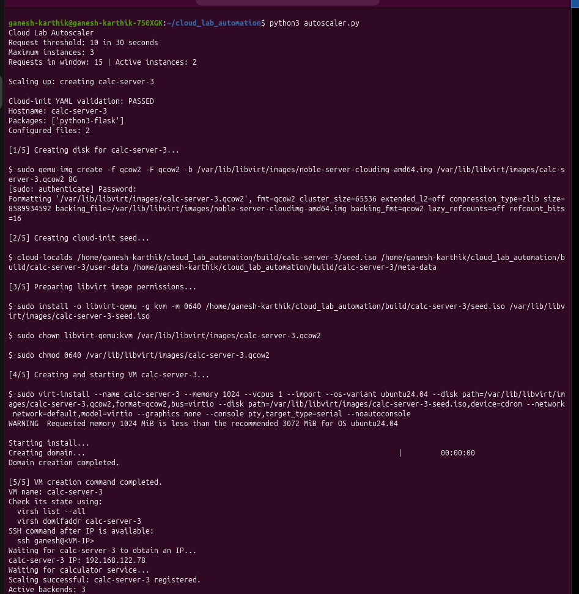
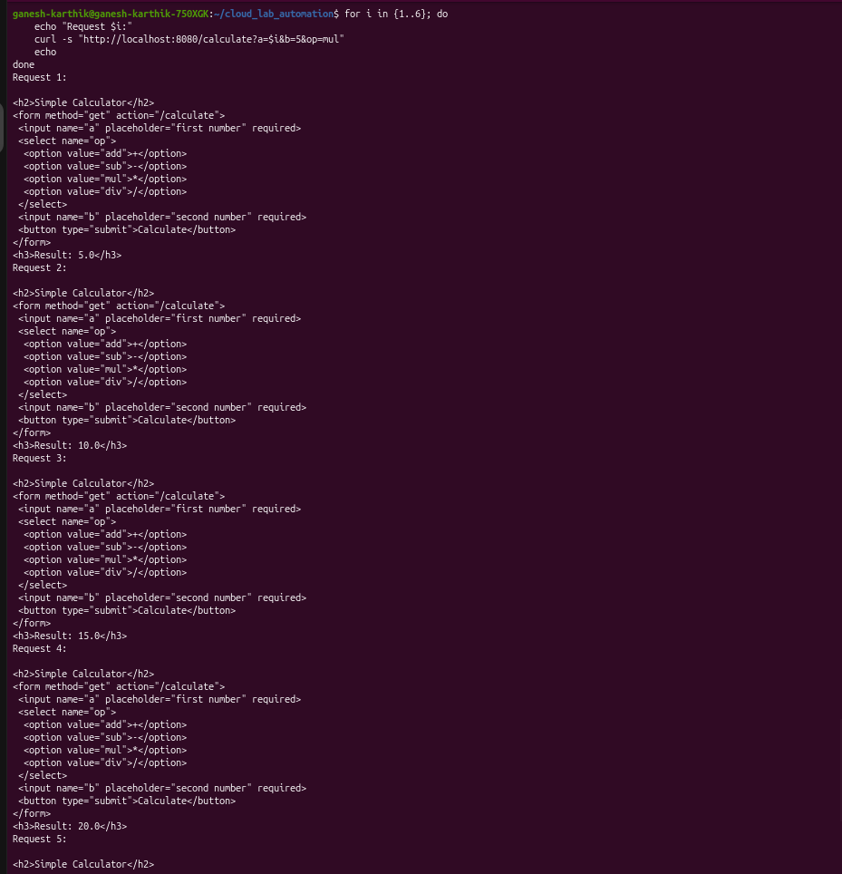
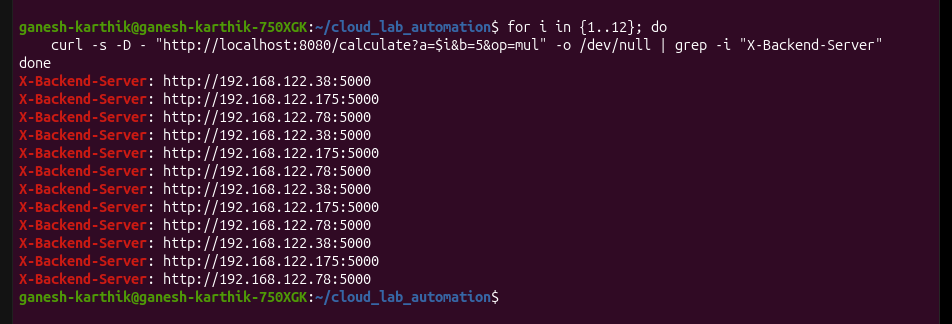
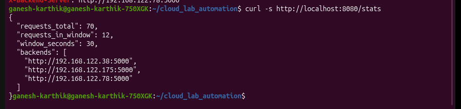
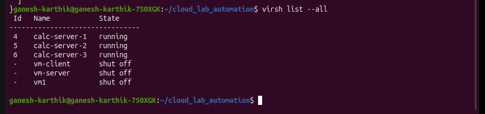
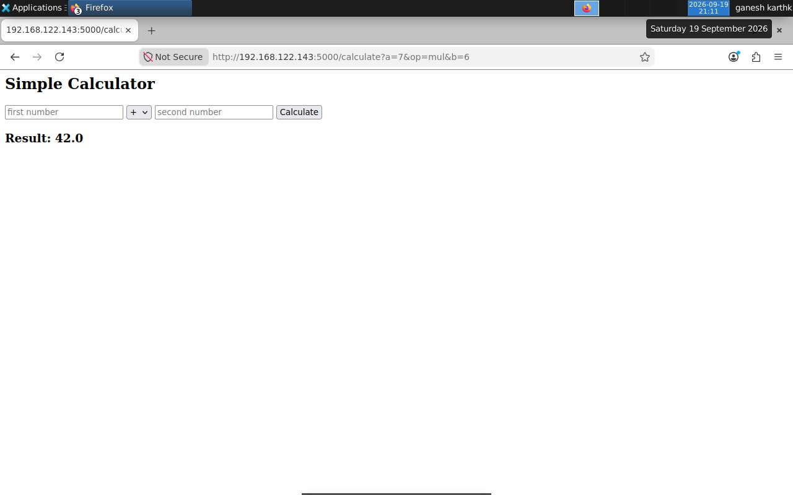

# Cloud Lab Automation: Dynamic VM Provisioning and Load Balancing

A Python-based cloud automation project demonstrating virtual machine provisioning, automated application deployment, HTTP load balancing, request monitoring, and threshold-based autoscaling using **KVM/QEMU, libvirt, cloud-init, and Flask**.

The system automatically provisions additional calculator backend VMs when incoming traffic exceeds a configured threshold, verifies their health, and dynamically registers them with the load balancer.

---

## Table of Contents

- [Overview](#overview)
- [Architecture](#architecture)
- [Technology Stack](#technology-stack)
- [Project Structure](#project-structure)
- [Implementation Details](#implementation-details)
- [Configuration](#configuration)
- [Prerequisites](#prerequisites)
- [Running the Project](#running-the-project)
- [Testing and Verification](#testing-and-verification)
- [Demonstration and Screenshots](#demonstration-and-screenshots)
- [Limitations](#limitations)
- [Learning Outcomes](#learning-outcomes)

---

## Overview

This project implements a small cloud environment on a local Ubuntu machine using KVM/QEMU and libvirt.

It consists of multiple virtual machines running a Flask-based calculator application, a Python HTTP load balancer, a request monitoring component, and an autoscaler.

The main objective is to demonstrate how infrastructure can respond dynamically to increased application traffic.

### Key Features

- Automated virtual machine creation using Python.
- VM configuration and application deployment using cloud-init.
- Flask calculator application deployed on backend VMs.
- HTTP load balancing using round-robin scheduling.
- Dynamic backend registration through a JSON configuration file.
- Request monitoring using a rolling 30-second window.
- Threshold-based automatic VM provisioning.
- Health-check-based backend registration.
- Configurable cooldown period and maximum VM count.
- Browser and command-line access to the calculator application.

---

## Architecture

The system consists of a client-facing load balancer, multiple calculator backend VMs, and an autoscaler that monitors incoming traffic.

```text
                    Client
                      |
                HTTP Requests
                      |
                      v
             +------------------+
             |   Load Balancer  |
             |   Port: 8080     |
             +------------------+
                      |
             Round-Robin Routing
                      |
          +-----------+-----------+
          |           |           |
          v           v           v
     +---------+ +---------+ +---------+
     | Server 1| | Server 2| | Server 3|
     | :5000   | | :5000   | | :5000   |
     +---------+ +---------+ +---------+
          |           |           |
          +-----------+-----------+
                      |
               Calculator App
                   Flask

                      |
                      v
             +------------------+
             | Request Counter  |
             | 30-second Window |
             +------------------+
                      |
                      v
             +------------------+
             |    Autoscaler    |
             +------------------+
                      |
             Threshold Exceeded?
                      |
                      v
             +------------------+
             |   VM Provisioner |
             |   create_vm.py   |
             +------------------+
                      |
                      v
                 New VM Created
                      |
                      v
                  Health Check
                      |
                      v
              Backend Registration
```

### Autoscaling Workflow

1. The load balancer receives incoming calculator requests.
2. The request counter tracks total requests and requests within the latest 30 seconds.
3. The autoscaler polls the load balancer statistics endpoint every 5 seconds.
4. When the request count reaches the configured threshold, the autoscaler initiates VM provisioning.
5. The provisioning script creates a virtual disk and cloud-init configuration.
6. The new VM is started using libvirt.
7. The autoscaler discovers its IP address.
8. It waits for the calculator application's health endpoint to respond.
9. Once healthy, the new backend is added to `backends.json`.
10. The load balancer dynamically detects the updated backend list and includes the new VM in request distribution.

---

## Technology Stack

| Component               | Technology                     |
| ----------------------- | ------------------------------ |
| Host OS                 | Ubuntu Linux                   |
| Virtualization          | KVM / QEMU                     |
| VM Management           | libvirt                        |
| VM Provisioning         | Python, virt-install, qemu-img |
| Automated Configuration | cloud-init                     |
| Backend Application     | Python, Flask                  |
| Load Balancer           | Python HTTP server             |
| Monitoring              | Python threading and deque     |
| Configuration           | JSON                           |
| Guest OS                | Ubuntu Server 24.04            |

---

## Project Structure

```text
cloud_lab_automation/
│
├── calculator_app.py
├── create_vm.py
├── load_balancer.py
├── request_counter.py
├── autoscaler.py
├── backends.json
├── README.md
├── .gitignore
│
├── build/                  # Generated cloud-init configuration
│
└── screenshots/
    ├── 06_01_autoscaling_full.png
    ├── 06_02_autoscaling_success.png
    ├── 06_03_calculator_results.png
    ├── 06_04_three_backend_distribution.png
    ├── 06_05_load_balancer_stats.png
    ├── 06_06_vm_status.png
    └── 06_07_calculator_browser.png
```

---

## Implementation Details

### 1. Virtual Machine Provisioning

**File:** `create_vm.py`

The provisioning script automates virtual machine creation using libvirt and QEMU.

Responsibilities:

- Creates virtual machine disks using `qemu-img`.
- Uses a base Ubuntu cloud image with linked QCOW2 disks.
- Generates cloud-init user-data and metadata.
- Creates cloud-init seed images using `cloud-localds`.
- Configures VM resources such as memory, CPU, and disk size.
- Creates and starts virtual machines using `virt-install`.

The script also deploys the calculator application automatically through cloud-init.

### 2. Automated Application Deployment

**File:** `calculator_app.py`

Each backend VM runs a Flask-based calculator application.

The application supports:

- Addition
- Subtraction
- Multiplication
- Division
- Health monitoring through `/health`

The application listens on port `5000` and is configured to run as a systemd service.

This allows the application to start automatically when the VM boots.

### 3. Load Balancer

**File:** `load_balancer.py`

The load balancer accepts HTTP requests on port `8080` and forwards them to backend calculator instances.

Features:

- Round-robin request distribution.
- Dynamic backend configuration through `backends.json`.
- Backend identification using the `X-Backend-Server` response header.
- Request forwarding to Flask applications.
- Statistics endpoint at `/stats`.

The backend list is reloaded dynamically, allowing newly provisioned VMs to participate in load balancing without restarting the load balancer.

### 4. Request Counter

**File:** `request_counter.py`

The request counter tracks application traffic.

It maintains:

- Total number of requests received.
- Request timestamps.
- Number of requests within a configurable rolling time window.

A thread lock protects shared counter data, while a deque stores request timestamps efficiently.

Old timestamps are removed when they fall outside the monitoring window.

### 5. Autoscaler

**File:** `autoscaler.py`

The autoscaler monitors incoming traffic and provisions additional backend VMs when required.

Current behavior:

- Polls `/stats` every 5 seconds.
- Checks the number of requests in the latest 30-second window.
- Triggers scaling when the threshold is reached.
- Enforces a cooldown period between scaling operations.
- Enforces a maximum number of backend instances.
- Creates VMs using `create_vm.py`.
- Discovers the new VM's IP address.
- Waits for its calculator health endpoint.
- Registers the new backend in `backends.json`.

The backend is registered only after the health check succeeds.

---

## Configuration

The following values were used during the demonstration.

| Parameter                   |       Value |
| --------------------------- | ----------: |
| Load balancer port          |        8080 |
| Backend application port    |        5000 |
| Monitoring window           |  30 seconds |
| Autoscaling threshold       | 10 requests |
| Autoscaler polling interval |   5 seconds |
| Cooldown period             | 120 seconds |
| Maximum instances           |           3 |
| VM memory                   |    1024 MiB |
| VM CPU                      |      1 vCPU |
| VM disk                     |        8 GB |

The autoscaling parameters can be modified in `autoscaler.py`.

---

## Prerequisites

The host machine requires:

- Ubuntu Linux.
- KVM/QEMU virtualization support.
- libvirt.
- Python 3.
- Flask and other required Python packages.
- cloud-init utilities.
- Ubuntu Server cloud image.

The host must have hardware virtualization enabled.

---

## Running the Project

Run the commands from the project directory.

### 1. Start the Load Balancer

```bash
cd ~/cloud_lab_automation
python3 load_balancer.py
```

The load balancer starts listening on port `8080`.

### 2. Start the Autoscaler

Open another terminal:

```bash
cd ~/cloud_lab_automation
python3 autoscaler.py
```

The autoscaler begins monitoring request statistics.

### 3. Generate Calculator Requests

```bash
for i in {1..12}; do
    curl -s -D - \
    "http://localhost:8080/calculate?a=$i&b=5&op=mul" \
    -o /dev/null | grep -i "X-Backend-Server"
done
```

This sends twelve multiplication requests through the load balancer.

### 4. View Load Balancer Statistics

```bash
curl -s http://localhost:8080/stats
```

### 5. Check Virtual Machine Status

```bash
virsh list --all
```

### 6. Access the Calculator in a Browser

Open the calculator application using the IP address of a running backend VM:

```text
http://<VM-IP>:5000
```

For example:

```text
http://192.168.122.143:5000
```

Replace the IP with the current address assigned to your VM.

---

## Testing and Verification

The system was tested with three calculator backend VMs.

### Automatic Provisioning

The autoscaler detected a request count exceeding the configured threshold and automatically created `calc-server-3`.

The new VM received the IP address:

`192.168.122.78`

Its calculator health endpoint became reachable, and the autoscaler successfully registered it as a backend.

### Round-Robin Load Balancing

Twelve consecutive requests were sent through the load balancer.

The observed distribution was:

| Backend       | IP Address      | Requests |
| ------------- | --------------- | -------: |
| calc-server-1 | 192.168.122.38  |        4 |
| calc-server-2 | 192.168.122.175 |        4 |
| calc-server-3 | 192.168.122.78  |        4 |
| **Total**     |                 |   **12** |

### Load Balancer Statistics

The statistics endpoint returned:

```json
{
  "requests_total": 70,
  "requests_in_window": 12,
  "window_seconds": 30,
  "backends": [
    "http://192.168.122.38:5000",
    "http://192.168.122.175:5000",
    "http://192.168.122.78:5000"
  ]
}
```

These values represent a recorded test run.

### Virtual Machine Status

All three calculator instances were verified as running through libvirt.

| Virtual Machine | State   |
| --------------- | ------- |
| calc-server-1   | Running |
| calc-server-2   | Running |
| calc-server-3   | Running |

---

## Demonstration and Screenshots

The following screenshots document the implementation and testing process.

### 1. Automatic VM Provisioning

The autoscaler detects increased traffic and invokes the automated VM provisioning script.



### 2. Successful Autoscaling and Backend Registration

The new VM obtains an IP address, passes the application health check, and is registered as an active backend.


### 3. Calculator Results Through HTTP Requests

Multiplication requests are sent through the load balancer, and the calculator application returns the expected results.



### 4. Three-Backend Load Balancing

Twelve consecutive requests are distributed evenly across the three backend VMs using round-robin scheduling.



### 5. Load Balancer Statistics

The statistics endpoint displays request counts and the currently registered backend instances.



### 6. Virtual Machine Status

The three calculator backend VMs are verified as running using `virsh list --all`.



### 7. Calculator Application in Browser

The Flask calculator application is accessed from the **Client VM** through a web browser using the backend VM's network IP address and port `5000`. The screenshot demonstrates successful access to the calculator interface and a multiplication operation.



---

## Limitations

- The infrastructure runs locally using KVM/libvirt rather than a public cloud provider.
- The autoscaler uses a simple request-count threshold.
- Request statistics are maintained in memory and reset when the load balancer restarts.
- The system uses a fixed maximum instance count.
- The demonstration is intended for educational purposes and is not designed as a production-grade cloud deployment.

---

## Learning Outcomes

This project demonstrates practical implementation of:

- Virtualization and VM lifecycle management.
- Infrastructure automation using Python.
- Cloud-init-based VM configuration.
- Automated application deployment.
- HTTP request routing and load balancing.
- Traffic monitoring and rolling-window counters.
- Health checks and backend discovery.
- Threshold-based autoscaling.
- Dynamic infrastructure provisioning.

---

**Project:** Cloud Lab Automation  
**Environment:** Ubuntu Linux with KVM/QEMU and libvirt  
**Backend:** Python and Flask
